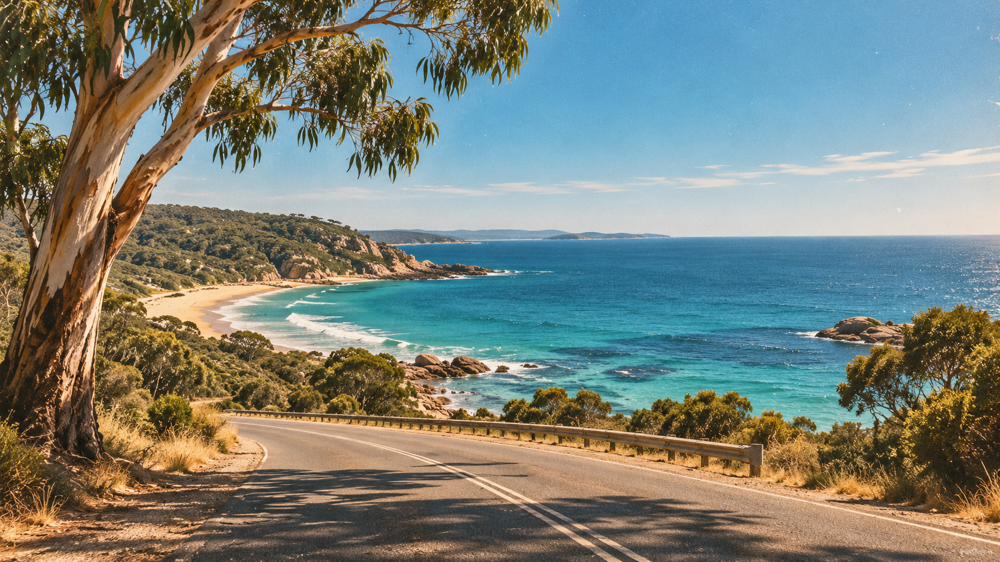
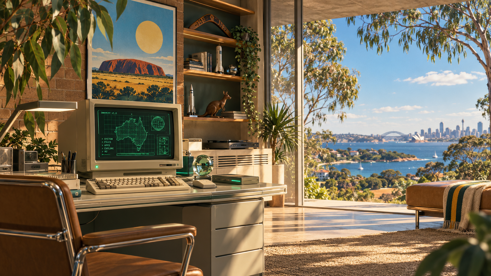

# Australiana

A warm, nostalgic Australian theme for Omarchy: bush-green surfaces, soft gold text, wattle-gold accents, eucalyptus greens and outback rust.


## Install

```sh
git clone https://github.com/BennetMC2/omarchy-australiana-theme ~/.config/omarchy/themes/australiana
bash ~/.config/omarchy/themes/australiana/install.sh
```

Installation applies the theme. Designed for Omarchy 4 / Quattro's semantic colour templates; locally checked on Omarchy 4.0.4-1.

To select it later or choose a wallpaper:

```sh
omarchy theme set australiana
omarchy theme bg-switcher
```

## Wallpapers

Five backgrounds are included:

| Bush evening | Summer cricket |
| --- | --- |
|  |  |
| Coastal road | Main street |
|  |  |



## Palette

| Role | Colour |
| --- | --- |
| Background | `#102C23` |
| Deep forest | `#0B2119` |
| Soft gold text | `#E8C778` |
| Wattle gold accent | `#E7AD35` |
| Eucalyptus | `#A3B980` |
| Coastal blue | `#89B4C1` |
| Warm rust | `#E58A68` |

Omarchy generates the terminal, editor, shell and other supported application configurations from `colors.toml`. Folder icons use `Yaru-yellow`.

## Kangaroo About logo

The installer registers a theme-change hook. Selecting Australiana displays a gold kangaroo in terminal dot art; switching to another theme restores the previous About logo. Your Fastfetch configuration is preserved. Python 3 is required for the hook.

If you already installed the palette with `omarchy theme install`, run the `install.sh` command above once to enable the kangaroo integration. Ordinary theme installation does not execute repository scripts automatically.

Preview with `omarchy launch about`. The source silhouette and dot art are included in `branding/`.

To disable the integration, switch to another theme first, then remove only `~/.config/omarchy/hooks/theme-set.d/australiana-about`.

## Australiana extras

The full installer also adds:

- A quiet 3.2-second kookaburra welcome when switching into Australiana. Refreshing the current theme stays silent; rapid switches have a 60-second cooldown.
- A gold kangaroo with “Gone walkabout” and “Back in a tick” above the usual lock-screen password field.
- A gold roo beside the bar menu. It hops occasionally (every 2–5 minutes). Left-click opens wallpaper choices; right-click toggles the welcome sound. A dimmed roo means muted.

The bar roo and lock decoration hide when another theme is selected. Mute persists in `~/.config/omarchy/australiana.json`. You can also control it from a terminal:

```sh
python3 ~/.config/omarchy/themes/australiana/extras/australiana.py mute
python3 ~/.config/omarchy/themes/australiana/extras/australiana.py unmute
omarchy bar set australiana.roo animate false
```

The sound uses PipeWire's `pw-play` and follows system volume/mute. [Recording credit](extras/sounds/CREDITS.md).

The installer clones the installed Omarchy lock plugin into your user configuration and adds only a decorative component. Its authentication service is unchanged. Run the installer again after updating this repository to refresh the installed widget and hook. Theme marketplace installation only supplies palette and wallpaper assets; use the full Git clone and installer above for these extras.

To remove the extras, first switch away from Australiana, disable `australiana.roo` with `omarchy plugin disable australiana.roo`, and disable your lock clone (normally `<your-username>.lock`) with `omarchy plugin disable <your-username>.lock` to restore the built-in lock screen. Remove `~/.config/omarchy/hooks/theme-set.d/australiana-extras` to stop the welcome sound hook.

## Artwork

The bush-evening wallpaper and kangaroo silhouette were generated with OpenAI's image generation tool. The four nostalgic photographic-style wallpapers were supplied for this theme. The preview is the bush-evening wallpaper, not a desktop screenshot. Prompts are retained in `wallpaper-prompt.txt` and `branding/kangaroo-prompt.txt`; the wallpaper prompt uses the theme's final name.

No separate licence for the artwork is declared in this repository.
