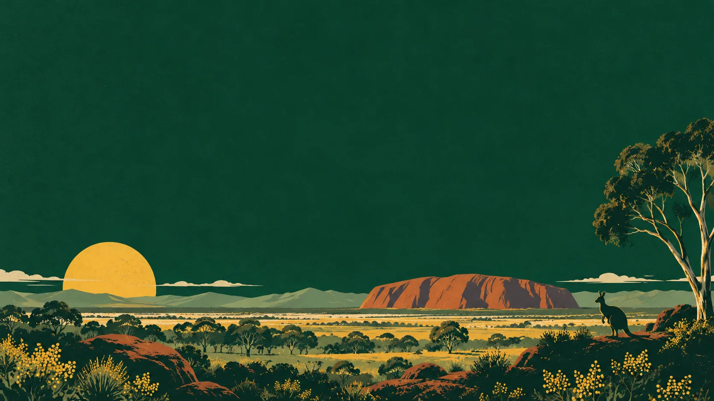
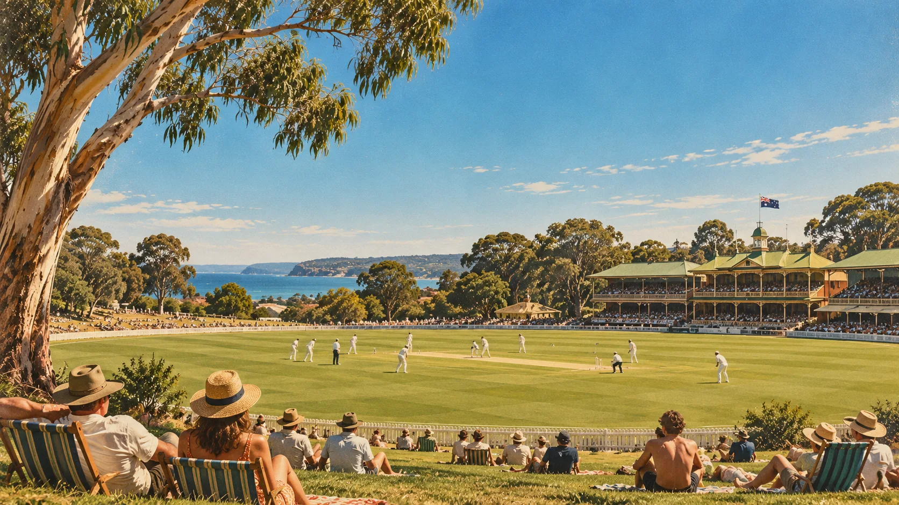
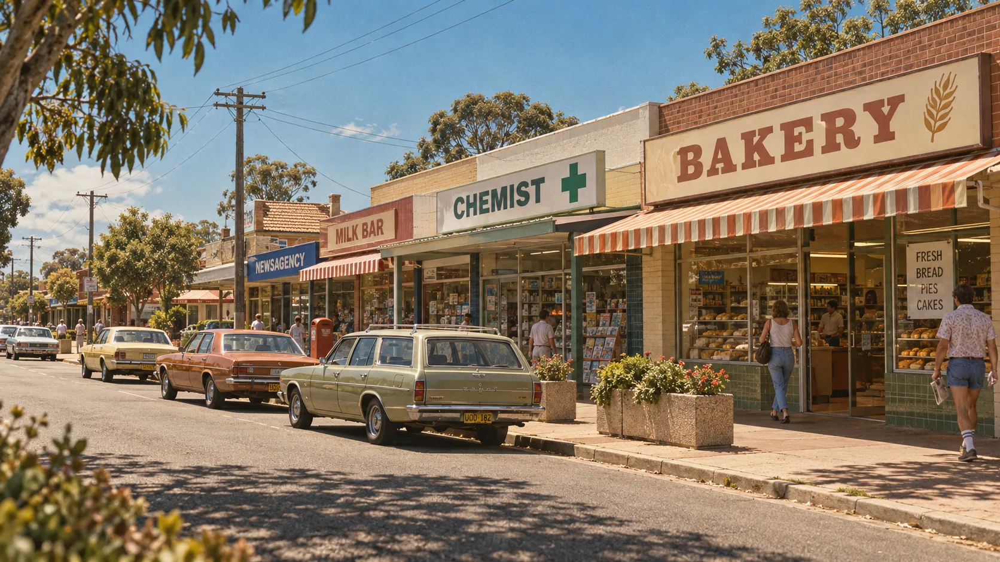

# Australiana

A warm, nostalgic Australian theme for Omarchy: bush-green surfaces, soft gold text, wattle-gold accents, eucalyptus greens and outback rust.


## Install

Install and apply the theme using Omarchy's standard theme installer:

```sh
omarchy theme install https://github.com/BennetMC2/omarchy-australiana-theme
```

Designed for Omarchy 4 / Quattro's semantic colour templates. This repository contains the palette, wallpapers and icon-theme selection; no custom installer is required.

To select it later or choose a wallpaper:

```sh
omarchy theme set australiana
omarchy theme bg-switcher
```

## Wallpapers

Five backgrounds are included:

| Bush evening | Summer cricket |
| --- | --- |
|  |  |
| Coastal road | Main street |
|  |  |


## Palette

| Role | Colour |
| --- | --- |
| Background | `#102C23` |
| Deep forest | `#0B2119` |
| Soft gold text | `#E8C778` |
| Wattle gold accent | `#E7AD35` |
| Eucalyptus | `#A3B980` |
| Coastal blue | `#89B4C1` |
| Warm rust | `#E58A68` |

Omarchy generates the terminal, editor, shell and other supported application configurations from `colors.toml`. Folder icons use `Yaru-yellow`.

## Optional enhancements

The custom kangaroo About logo, kookaburra welcome sound, lock-screen decoration and animated bar widget are not part of this gallery theme. Their source and assets are preserved at [the last revision containing the extras](https://github.com/BennetMC2/omarchy-australiana-theme/tree/48dd9faf9dd5aa039a908837bf7df09f25b1bbc9), for possible maintenance as a separate optional extension. No separate extension release is currently provided; the historical installer is not an installation method for this version.

### Upgrading from the old custom installer

If you previously ran the custom installer, clean up its user-installed integrations **before updating or reinstalling this theme**. Standard theme installation does not remove existing hooks or plugins:

1. Switch to another installed theme first, while the old files still exist. This lets the old About hook restore your previous logo.
2. Disable the `australiana.roo` plugin. If you enabled the decorated lock clone, disable that clone (normally `<your-username>.lock`) to restore the built-in lock screen. Use Omarchy's plugin controls; do not disable the built-in lock plugin.
3. Remove only the old `australiana-about` and `australiana-extras` hook entries from `~/.config/omarchy/hooks/theme-set.d/`. Keep unrelated hooks and your Fastfetch configuration.
4. Install the theme using the standard command above.

Disabling the plugins leaves their copied source in your user configuration for recovery. The preserved historical README documents the old integrations. If the old files were already removed, recover them from the linked revision before performing the switch-away step.

## Artwork

The bush-evening wallpaper was generated with OpenAI's image generation tool. The four nostalgic photographic-style wallpapers were supplied for this theme. The preview is the bush-evening wallpaper, not a desktop screenshot. The wallpaper prompt is retained in `wallpaper-prompt.txt`.

No separate licence for the artwork is declared in this repository.
